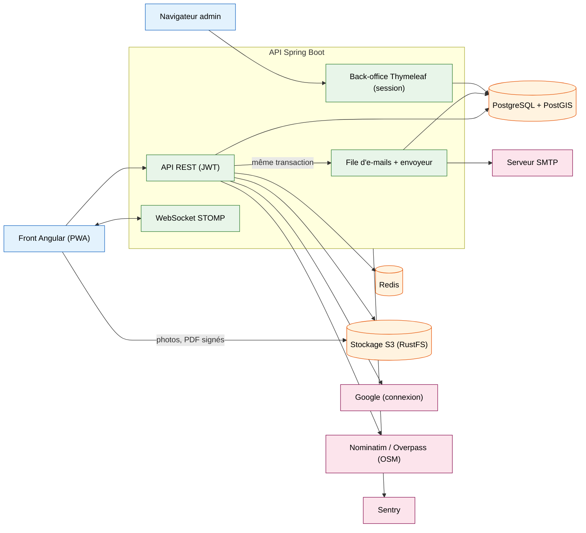

# Kupanga API


-C72E49?style=for-the-badge)


**Kupanga** est une plateforme de gestion locative entre propriétaires et locataires, pensée pour la **France** et le
**Congo (RDC, Kinshasa)** : publication et recherche de biens, bail signé en ligne, états des lieux, quittances PDF,
suivi des loyers reçus, messagerie temps réel, notifications et back-office d'administration.

Ce dépôt contient l'**API** (Spring Boot). Le front Angular est dans
[`kupanga-front`](https://github.com/Kupanga-App/kupanga-front).

> **Démarrer en local : [GUIDE-DEMARRAGE.md](GUIDE-DEMARRAGE.md)** (de zéro, environ 30 minutes).

---

## Sommaire

1. [Fonctionnalités](#fonctionnalités)
2. [Démarrage rapide](#démarrage-rapide)
3. [Architecture](#architecture)
4. [Configuration](#configuration)
5. [Sécurité](#sécurité)
6. [Back-office](#back-office)
7. [Tests et CI](#tests-et-ci)
8. [Mise en production](#mise-en-production)
9. [Documentation du projet](#documentation-du-projet)

---

## Fonctionnalités

| Domaine | Ce que fait l'API |
|---|---|
| **Comptes** | Inscription avec **confirmation de l'adresse e-mail** (lien 24 h), connexion e-mail / mot de passe ou **Google**, refresh token en cookie HttpOnly, mot de passe oublié, téléphone de contact facultatif (format international), suppression ou anonymisation d'un compte |
| **Biens** | Création, modification et archivage (jamais supprimés), photos réduites (1600 px + vignette 400 px, sans données EXIF/GPS), repère sur la carte ou position calculée (adresse → quartier → commune → ville), points d'intérêt à proximité (écoles, pharmacies…), recherche publique multi-critères, position publique arrondie à ~100 m |
| **Plusieurs pays** | Un **profil par pays** (FR, CD) : devises (EUR ; USD et CDF), champs d'adresse (code postal, ou commune / quartier / avenue / parcelle), champs obligatoires et masqués, types de bien et équipements, modes de paiement, compteurs d'EDL, canaux de notification. Le pays, la devise et la version du modèle sont **figés sur chaque bail, EDL et quittance** |
| **Documents** | Bail, état des lieux et quittance en PDF, un modèle par pays et par version (modèle RDC provisoire, à faire valider par un juriste), signature en ligne du propriétaire puis du locataire, liens de signature valables 72 h |
| **Loyers** | Le propriétaire déclare le loyer reçu hors application (espèces, Mobile Money, virement…) avec la photo du reçu ; **aucun paiement ne transite par l'application** |
| **Messagerie** | Conversations propriétaire ↔ candidat / locataire en temps réel (WebSocket STOMP), règles d'ouverture d'une conversation, accusés d'envoi, rattrapage après reconnexion |
| **Notifications** | Notifications en base et en temps réel ; liens **WhatsApp** préremplis (`wa.me`) pour les invitations à signer et les rappels de loyer, envoyés par le propriétaire depuis son téléphone |
| **E-mails** | Par **n'importe quel serveur SMTP** ; **aucun e-mail perdu** : file d'envoi en base, écrite avec l'action qui le demande, nouveaux essais pendant ~46 h, alerte en cas d'échec d'un e-mail important |
| **Fichiers** | Stockage **compatible S3** (RustFS en dev et en CI ; tout serveur S3 par configuration) : photos des biens publiques ; documents, reçus et photos de profil privés, lus par URL signée à durée limitée |
| **Back-office** | Interface d'administration web : statistiques, utilisateurs, biens, documents d'un bien, suivi des e-mails |

---

## Démarrage rapide

Prérequis : Git, Docker, JDK 21. Le pas à pas est dans le [guide de démarrage](GUIDE-DEMARRAGE.md).

```bash
git clone https://github.com/Kupanga-App/kupanga-Api.git && cd kupanga-Api
cp .env.dev.exemple .env.dev        # puis changer JWT_SECRET_KEY et ADMIN_PASSWORD
docker compose -f docker-compose-dev.yml up -d --build
```

| Service | Adresse |
|---|---|
| API | http://localhost:8089 |
| Swagger | http://localhost:8089/swagger-ui.html |
| Back-office | http://localhost:8089/backoffice/login |
| Mailpit (e-mails capturés) | http://localhost:8025 |
| Console RustFS (fichiers) | http://localhost:9001 — `kupanga-dev` / `kupanga-dev-secret` |
| PostgreSQL + PostGIS | `localhost:5433` / `kupanga_dev` |
| Redis / RedisInsight | `localhost:6379` / http://localhost:5540 |

---

## Architecture

### Stack

| Couche | Choix |
|---|---|
| Langage, framework | Java 21, Spring Boot 3.2 (Web, Security, Data JPA, Validation, WebSocket, Mail, Cache, Actuator) |
| Base de données | PostgreSQL 15 + PostGIS ; schéma géré par **Flyway** (migrations `V1` à `V52`), vérifié par Hibernate (`validate`) |
| Cache et limites de tentatives | Redis (Bucket4j) ; l'application continue de fonctionner si Redis tombe |
| Fichiers | SDK AWS v2 (S3 générique) — RustFS en dev et en CI |
| E-mails | SMTP générique (`spring.mail.*`) et file d'envoi persistante `emails_sortants` |
| Documents PDF | Thymeleaf + Flying Saucer, modèles `templates/documents/<pays>/<version>/` |
| Temps réel | STOMP sur WebSocket / SockJS (broker en mémoire, battements 5 s / 10 s) |
| Mapping, code | MapStruct, Lombok |
| Observabilité | Sentry (sans données personnelles), Actuator (`/actuator/health`) |
| Documentation de l'API | springdoc OpenAPI (Swagger), désactivé en production |

### Modules (`com.kupanga.api.*`)

| Package | Rôle |
|---|---|
| `authentification` | Inscription, connexion, Google, JWT, refresh token, confirmation d'adresse, limites de tentatives |
| `user` | Comptes, profils, téléphone, recherche de candidats |
| `immobilier` | Biens, photos, localisation, points d'intérêt, contrats, états des lieux, quittances, PDF |
| `juridiction` | Pays, profils de juridiction (`application.yml` → `kupanga.juridictions`), règles par pays, devises, plafonds |
| `chat` | Conversations, messages, WebSocket STOMP |
| `notification` | Notifications en base et temps réel, liens WhatsApp |
| `email` | Préparation des e-mails, envoi SMTP (`envoi`), file d'envoi persistante (`file`) |
| `stockage` | Stockage S3, préparation des buckets, traitement des images (réduction, nettoyage EXIF) |
| `backoffice` | Administration (Thymeleaf) et sa chaîne de sécurité |
| `config`, `exception`, `pagination` | Configuration transverse, erreurs JSON homogènes, pagination |

### Vue d'ensemble



**Envoi d'un e-mail** : l'action (inscription, signature, quittance…) écrit l'e-mail dans `emails_sortants` **dans
la même transaction** ; rien ne part si elle est annulée. Après le commit, l'envoyeur l'expédie en quelques
secondes ; une tâche planifiée reprend toutes les 30 s ce qui n'est pas parti (panne SMTP, redémarrage). Essais à
1 min, 5 min, 15 min, 1 h, 3 h, 6 h, 12 h puis 24 h ; un e-mail dont le lien a expiré entre-temps n'est pas envoyé ;
le contenu (qui contient des liens à jeton) est effacé dès l'envoi.

---

## Configuration

Tout se règle par variables d'environnement. Profils : `dev` (défaut en local, lit `.env.dev`), `test`, `prod`
(défaut de l'image Docker).

### Développement

Voir [`.env.dev.exemple`](.env.dev.exemple) : seules `JWT_SECRET_KEY` et `ADMIN_PASSWORD` sont à choisir. Le
stockage (RustFS) et les e-mails (Mailpit) sont configurés par `docker-compose-dev.yml`.

### Production

| Variable | Obligatoire | Rôle |
|---|---|---|
| `SPRING_PROFILES_ACTIVE` | non (`prod` par défaut dans l'image) | profil |
| `PORT` | non | port HTTP (10000 dans l'image) |
| `DB_URL`, `POSTGRES_USER`, `POSTGRES_PASSWORD` | oui | base PostgreSQL + PostGIS |
| `REDIS_URL` | oui | Redis (`redis://…` ou `rediss://…`) |
| `JWT_SECRET_KEY` | oui | clé de signature des JWT (base64, ≥ 32 octets) |
| `ADMIN_EMAIL`, `ADMIN_PASSWORD` | oui | compte du back-office |
| `GOOGLE_CLIENT_ID` | non | connexion Google |
| `FRONTEND_URL`, `CORS_ALLOWED_ORIGINS` | non (domaine actuel par défaut) | adresse du front (liens des e-mails), origines autorisées |
| `STOCKAGE_ENDPOINT` | oui | URL du serveur S3 vue par l'API |
| `STOCKAGE_URL_PUBLIQUE` | oui | URL du serveur S3 vue par le navigateur (photos, URL signées) |
| `STOCKAGE_ACCESS_KEY`, `STOCKAGE_SECRET_KEY` | oui | compte de **service** limité aux buckets de Kupanga |
| `STOCKAGE_REGION`, `STOCKAGE_PATH_STYLE`, `STOCKAGE_GERER_POLITIQUES` | non (`us-east-1`, `true`, `true`) | région, style d'URL, droits des buckets posés par l'API (`false` pour un serveur sans politiques de bucket) |
| `SMTP_HOST`, `SMTP_USERNAME`, `SMTP_PASSWORD` | oui | serveur SMTP (Brevo : `smtp-relay.brevo.com` et la clé SMTP du compte) |
| `SMTP_PORT`, `SMTP_STARTTLS`, `SMTP_SSL`, `SMTP_AUTH` | non (`587`, `true`, `false`, `true`) | connexion SMTP ; **chiffrement obligatoire en prod** (STARTTLS ou SSL, sinon refus de démarrer) |
| `EMAIL_EXPEDITEUR` | oui | adresse d'envoi, sur un domaine authentifié (SPF, DKIM, DMARC) |
| `EMAIL_NOM_EXPEDITEUR`, `EMAIL_REPONDRE_A` | non (`Kupanga`, vide) | nom affiché, adresse de réponse |
| `EMAIL_ENVOI_INTERVALLE` | non (`30s`) | reprise de la file d'e-mails |
| `SENTRY_DSN` | oui | suivi des erreurs |

**Buckets** créés au démarrage : `bucket-photo-immobilier` (public) ; `bucket-photo-profil`, `contrat-de-bail`,
`bucket-etats-des-lieux`, `bucket-des-quittances`, `bucket-recus-paiement` (privés). Droits du compte de service :
`s3:ListBucket` et `s3:GetBucketLocation` sur les buckets ; `s3:GetObject`, `s3:PutObject`, `s3:DeleteObject` sur
leurs objets ; `s3:GetBucketPolicy`, `s3:PutBucketPolicy`, `s3:DeleteBucketPolicy` si `STOCKAGE_GERER_POLITIQUES=true` ;
`s3:CreateBucket` pour le premier démarrage. Si un bucket privé se révèle lisible sans authentification, l'API le
signale (log ERROR) et refuse d'y écrire.

---

## Sécurité

- **Deux chaînes Spring Security** : `/backoffice/**` (session + formulaire, CSRF, compte admin unique défini par
  variables d'environnement) et le reste de l'API (**JWT sans état**, fermée par défaut, rôles propriétaire /
  locataire, 401 sans jeton, 403 sur la ressource d'autrui).
- Comptes : adresse confirmée avant la première connexion, adresse Google exigée confirmée, inscription et mot de
  passe oublié sans révéler l'existence d'un compte, e-mails insensibles à la casse.
- **Limites de tentatives** (Bucket4j sur Redis) : connexion, inscription, mot de passe oublié, renvoi du lien,
  Google, login du back-office, ouverture de conversations.
- Données personnelles : aucune adresse e-mail ni donnée du locataire dans les vues publiques ; documents, reçus
  et photos de profil en buckets privés (URL signées : 5 min pour les documents, 24 h pour les avatars) ; ni contenu
  de message, ni adresse, ni jeton dans les logs ; Sentry sans données personnelles.
- Fichiers envoyés reconnus à leur contenu (et non à leur nom), photos réencodées sans métadonnées, bornes contre
  les images piégées ; tailles limitées (10 Mo par fichier, 50 Mo par requête).
- WebSocket : JWT exigé à la connexion, abonnements limités à ses propres files, destinations contrôlées.
- CORS et origines WebSocket restreintes ; Swagger désactivé en production ; SMTP chiffré exigé en production.

Le détail des contrôles est dans [`AUDIT-PRODUCTION.md`](AUDIT-PRODUCTION.md), l'historique dans `.claude/CLAUDE.md`.

---

## Back-office

Interface web **côté serveur** (Thymeleaf + Bootstrap 5) servie par l'API sous `/backoffice`, avec sa propre
authentification (session, compte admin unique `ADMIN_EMAIL` / `ADMIN_PASSWORD`, limite de tentatives).

| Route | Contenu |
|---|---|
| `/backoffice/login` | Connexion |
| `/backoffice/dashboard` | Utilisateurs, propriétaires, locataires, biens, villes, contrats, EDL, quittances, **e-mails en échec** |
| `/backoffice/analytics` | Statistiques détaillées |
| `/backoffice/users` | Recherche des comptes ; suppression (ou anonymisation si le compte a des biens ou des documents) |
| `/backoffice/biens` | Recherche des biens (dont filtre par pays) ; **archivage** et désarchivage (un bien n'est jamais supprimé) ; documents du bien |
| `/backoffice/emails` | File d'envoi : en attente, envoyés, en échec (adresse masquée, erreur SMTP) ; **renvoi** d'un e-mail en échec |

---

## Tests et CI

```bash
docker compose -f docker-compose-dev.yml --profile test up -d db-test   # base de test PostGIS (port 5434)
./mvnw verify
```

- ~840 tests : unitaires (JUnit 5, Mockito), intégration sur base réelle (`@DataJpaTest`, `@SpringBootTest`),
  sécurité (401 / 403 sur toutes les routes), WebSocket, SMTP réel (GreenMail), S3 réel (RustFS, ignorés s'il
  est absent), file d'e-mails avec deux envoyeurs concurrents.
- CI GitHub Actions (`.github/workflows/ci.yml`) : PostGIS, migrations Flyway, RustFS, Redis, build Maven, tests,
  image Docker.

---

## Mise en production

Image Docker (`Dockerfile`) : build Maven, exécution en utilisateur non root, profil `prod` par défaut, sonde
`/actuator/health/liveness`, arrêt propre.

L'hébergement cible est un **serveur unique** (VPS en France) avec Docker Compose, Caddy (HTTPS), Cloudflare,
PostgreSQL + PostGIS, Redis, RustFS et des sauvegardes chiffrées hors site : c'est le **Sprint 6**, décrit dans
[`AUDIT-INFRA.md`](AUDIT-INFRA.md) §3 et §4, **pas encore réalisé**. La mise en service partira d'une infrastructure
et d'une base neuves : Flyway crée tout le schéma au premier démarrage.

Serveur envisagé : **VPS-2 d'OVHcloud** (4 vCores, 8 Go, 75 Go NVMe, ~8,65 € TTC / mois) — comparaison des offres,
consommation du back-end et capacités estimées (requêtes par seconde, utilisateurs, connexions WebSocket) dans
[CHOIX-SERVEUR.md](CHOIX-SERVEUR.md).

Avant d'accueillir de vrais clients : CGU et politique de confidentialité, validation juridique des modèles de
documents RDC, recette sur téléphones réels (`AUDIT-INFRA.md` §5).

---

## Documentation du projet

| Document | Contenu |
|---|---|
| [GUIDE-DEMARRAGE.md](GUIDE-DEMARRAGE.md) | Installation et premier parcours, de zéro |
| [AUDIT-PRODUCTION.md](AUDIT-PRODUCTION.md) | Audit sécurité et fonctionnel (France + Congo), plan des Sprints 1 à 4 |
| [AUDIT-INFRA.md](AUDIT-INFRA.md) | Stockage, e-mails, hébergement (Sprints 5 et 6) |
| [CHOIX-SERVEUR.md](CHOIX-SERVEUR.md) | Choix du VPS OVHcloud : prix, consommation, capacités estimées par offre |
| `.claude/CLAUDE.md` | Mémoire du projet : décisions, avancement, points ouverts, journal |
| [`kupanga-front`](https://github.com/Kupanga-App/kupanga-front) | Front Angular (PWA) |
